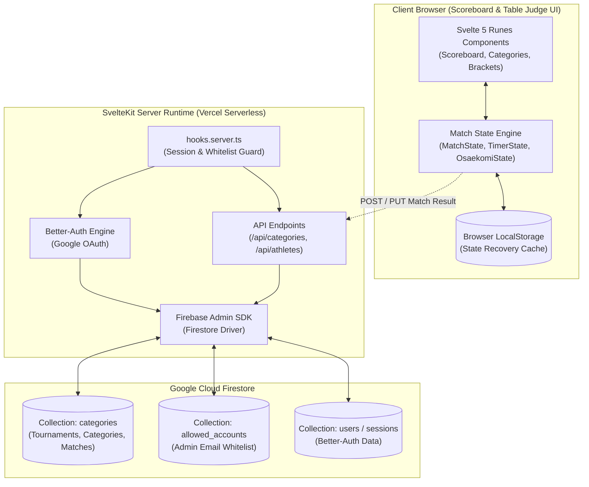

# System Architecture - JBCB Championship

Technical specification and architectural guide for the JBCB Championship tournament management system.

---

## 1. High-Level Architecture

The system is designed as a hybrid full-stack web application powered by **SvelteKit 2** and deployed to **Vercel**. It pairs a high-performance, zero-latency reactive client engine for real-time match scoring with a serverless backend interacting with **Firebase Firestore**.



---

## 2. Technology Stack

- **Application Framework**: [SvelteKit 2](https://kit.svelte.dev/) with [Svelte 5](https://svelte.dev/) utilizing runes (`$state`, `$derived`, `$effect`, `$props`).
- **Styling & UI Components**: [Tailwind CSS v4](https://tailwindcss.com/) alongside [Skeleton UI v4](https://skeleton.dev/) (`@skeletonlabs/skeleton`, `@skeletonlabs/skeleton-svelte`).
- **Database & Persistence**: [Firebase Admin SDK](https://firebase.google.com/docs/admin/setup) interacting directly with Google Cloud Firestore in native mode.
- **Authentication**: [Better-Auth](https://www.better-auth.com/) configured with the `better-auth-firestore` adapter and Google Social OAuth provider.
- **State Manipulation & Utilities**:
  - `immer` (`produce`): Deterministic immutable state mutations.
  - `ramda`: Functional composition, array sorting, and predicates.
  - `zod`: Strict runtime schema validation for judoka, matches, categories, and bracket rounds.
  - `@svelte-put/shortcut`: Keyboard shortcut bindings for table scoreboard actions.
  - `nanoid`: Collision-resistant unique ID generation for matches and competitors.
- **Testing & Tooling**:
  - `vitest` with `@testing-library/svelte` and `happy-dom`.
  - `@vitest/coverage-v8` for coverage analysis.
  - `svelte-check` and `typescript` (strict mode).
  - `eslint` configured with `@antfu/eslint-config`, `eslint-plugin-svelte`, and `eslint-plugin-better-tailwindcss`.

---

## 3. Data Architecture & Firestore Schema

All tournament data resides in Firestore under root collections managed via typed converters:

### Collection: `categories`

Each document represents a competition category division within a tournament:

```typescript
interface CategoryBase {
  athletes: Judoka[];
  currentMatch: string | null;
  duration: number;
  id: string;
  matches: Match[];
  name: string;
  tournament: string;
  type: 'pool' | 'double_pool' | 'brackets';
}
```

#### Category Type Variants:

1. **`PoolCategory` (`type: 'pool'`)**:
   Standard round-robin structure where `matches` contains all pair pairings generated via the Berger rotation algorithm.
2. **`DoublePoolCategory` (`type: 'double_pool'`)**:
   Contains sub-pools and championship finals:
   ```typescript
   interface DoublePoolExtension {
     finalMatch: Match;
     pools: {
       A: Match[];
       aAthletes: Judoka[];
       B: Match[];
       bAthletes: Judoka[];
     };
     semifinals: [Match, Match];
   }
   ```
3. **`BracketsCategory` (`type: 'brackets'`)**:
   Contains structured double-elimination bracket rounds:
   ```typescript
   interface BracketsExtension {
     rounds: Array<{
       loser: Match[];
       repechage: Match[];
       winner: Match[];
     }>;
   }
   ```

### Collection: `allowed_accounts`

Administrative whitelist governing user access:

```typescript
interface AllowedUser {
  email: string;
  id: string;
}
```

---

## 4. Client-Side Reactive Match Engine

Match execution operates as a dedicated client-side state machine. Because scorekeeping at the table cannot afford network latency, all countdowns, pin timers, point additions, and victory condition evaluations are computed synchronously in memory.

### 4.1 State Modules

1. **`MatchState` (`src/lib/state/match/match-state.svelte.ts`)**:
   - Manages active match points: `ippon`, `wazari`, `yuko`, and `shido` for `white` and `blue` judoka.
   - Evaluates victory conditions reactively via `$effect` in `watchWinnerOrLoser(type)`.
   - Supports undo/correction via `removeIppon`, `removeWazari`, `removeYuko`, and `removeShido`.
2. **`TimerState` (`src/lib/state/match/timer-state.svelte.ts`)**:
   - Manages match clock running at 100ms intervals (tracking tenths of seconds).
   - Counts down from `duration` to `00:00`.
   - Automatically activates **Golden Score** mode upon timer expiration when points are tied, reversing the clock into an elapsed-time count-up.
3. **`OsaekomiState` (`src/lib/state/match/osaekomi-state.svelte.ts`)**:
   - Manages the active pin clock running at 1-second intervals.
   - Escalates points automatically:
     - **5s**: awards `Yuko`.
     - **10s**: revokes Yuko and awards `Waza-ari`.
     - **20s**: revokes Waza-ari and awards `Ippon` (halting the match).
   - Supports **Sonomama / Yoshi** (freezing both timer clocks together) and **Extra Time** (allowing a pin to finish if regulation time expires while hold is active).
4. **`localStorageMatchState` (`src/lib/state/match/local-storage-match-state.svelte.ts`)**:
   - Synchronizes live match state, scores, and active times to browser storage, preventing catastrophic data loss during accidental reloads.

---

## 5. Scoring & Victory Hierarchy (IJF 2026 Rules)

The software implements the official International Judo Federation scoring system effective from 01.01.2026:

### Regulation Time Evaluation

1. **Instant Win**:
   - Scored 1 `Ippon` (direct throw, 20s pin, or submission).
   - Scored 2 `Waza-ari` (_Waza-ari-awasete-ippon_).
   - Opponent receives 3 `Shido` (_Hansoku-make_ disqualification).
2. **Expiration of Regulation Time (`timer === 0`)**:
   - Athlete with more `Waza-ari` wins.
   - If `Waza-ari` are tied (e.g. 0-0 or 1-1), athlete with more `Yuko` wins.
   - If both `Waza-ari` and `Yuko` are equal, match enters **Golden Score**.

### Golden Score Evaluation

- The first athlete to score **any technical score** (1 `Yuko`, 1 `Waza-ari`, or 1 `Ippon`) or whose opponent receives a 3rd `Shido` immediately wins.

---

## 6. Tournament Progression & Tie-Breaking Algorithms

### 6.1 Berger Round-Robin Rotation (`createMatchesPool`)

For single pools and double-pool subgroups, the match pairing generator applies the standard Berger round-robin algorithm:

- If athlete count $N$ is odd, a dummy `undefined` competitor (Bye) is appended to make $N$ even.
- Competitors are partitioned into Group A and Group B.
- For each subsequent round $r \in [1, N-1]$, Group A rotates clockwise while fixing the first element, guaranteeing that every judoka faces every opponent exactly once with alternating sash colors where possible.

### 6.2 Single-Pool Ranking Formulation (`getRankingPool`)

Pool standings are computed using a four-tier hierarchical comparator:

1. **Match Points ($\mathcal{M}$)**:
   $$\mathcal{M} = 2 \times \text{Wins}$$
2. **Evaluation Points ($\mathcal{E}$)**:
   Quality points accumulated across winning matches:
   $$
   \mathcal{E}_i = \begin{cases}
   10 & \text{if won by Ippon, 2 Waza-ari, or opponent Hansoku-make} \\
   7 & \text{if won by 1 Waza-ari} \\
   5 & \text{if won by Yuko} \\
   7 & \text{fallback for non-technical victory}
   \end{cases}
   $$
3. **Head-to-Head Direct Clash**:
   If two judoka share identical $\mathcal{M}$ and $\mathcal{E}$, the winner of their direct individual match ranks higher.
4. **Circle of Beating Resolution**:
   If three or more competitors are tied in a cycle ($A \to B \to C \to A$) with identical $\mathcal{M}$ and $\mathcal{E}$, the tie is broken by total **remaining victory time** ($\mathcal{T}_{\text{win}}$):
   $$\mathcal{T}_{\text{win}} = \sum_{m \in \text{Victories}} t_{\text{final}} \times (1 \text{ if regulation else } -1)$$
   The judoka with the greatest remaining victory time (fastest victories) takes precedence.

### 6.3 Double-Elimination Bracket Tree (`createBrackets`)

For large categories:

- Computes bracket capacity $2^{\lceil \log_2 N \rceil}$ and seeds byes in Round 1.
- Defeated judoka from championship rounds drop into corresponding repechage brackets (`repechage` and `loser` lists).
- Culminates in two bronze-medal repechage finals (3rd place) and one gold-medal final (1st and 2nd place).

---

## 7. Security & Authentication Architecture

- **Session Authentication**: Managed via `Better-Auth` cookies verified on every non-public request in SvelteKit's `hooks.server.ts`.
- **Authorization Whitelist**: The user's authenticated Google email is verified against the Firestore `allowed_accounts` collection before rendering protected routes.
- **Public vs Protected Routes**:
  - Public: `/login`, `/error`.
  - Protected: `/`, `/settings`, `/categories/*`, `/new`, `/club-ranking`, `/print/*`.
